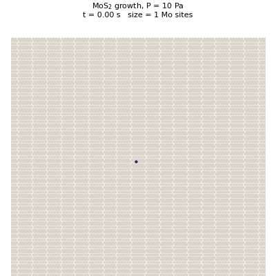
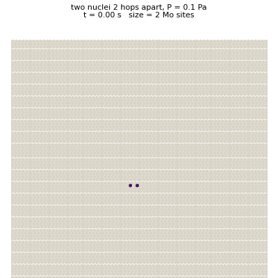

# Kinetic Monte Carlo model of MoS₂ flake growth

In CVD growth of MoS₂, a MoO₃ film on the substrate is converted to MoS₂ by sulfur
vapour. This repository is a small kinetic Monte Carlo (kMC) model of that conversion:
a flake grows outward from one nucleus as a **conversion front**, and its triangular
shape **emerges by itself** from the different speeds of the two zigzag edges.

<p align="center">
  
  
</p>

*Left: growth from one nucleus at P = 10 Pa. Right: at P = 0.1 Pa one nucleus cannot
grow, but two nuclei two sites apart can.*

The full write-up, with all the plots and the answers to the five questions, is in
**[`report.ipynb`](report.ipynb)** (also as [`report.pdf`](report.pdf) and a standalone [`report.html`](report.html)).

---

## How to run

You need Python ≥ 3.9 with NumPy, Matplotlib and Pillow (for the GIFs).

```bash
pip install -r requirements.txt

python run_experiments.py            # every experiment: figures, GIFs, numbers -> results/  (~5-10 min)
python run_experiments.py --quick    # fewer repeats, ~1-2 min
python run_experiments.py --only q1  # just one question (q1 ... q5)

python make_report.py                # rebuild report.ipynb from results/
```

Running one simulation yourself:

```python
from kmc import Params, Simulation
sim = Simulation(Params(P=10.0), seed=1).run()      # one nucleus in the centre
print(sim.summary())                                  # size, time, number of events, why it stopped
sim.history_t, sim.history_n                          # flake size against time
```

Two nuclei: `Simulation(params, nuclei=[site_a, site_b])`. Use
`lat.site_at_offset(site, k, steps)` to place a site `steps` hops away in direction `k`.

---

## The model in one page

| | |
|---|---|
| **Lattice** | 100 × 100 triangular lattice of Mo sites, 6 neighbours each. Mo never moves. |
| **States** | Each site is *oxide* or *MoS₂*. Oxide → MoS₂ only; the flake grows as a front. |
| **Sulfur** | Each oxide site has 2 S slots (MoS₂ has 2 S per Mo). |
| **Event 1: S adsorption** | rate = `k_ads · P · (empty slots)`. Proportional to sulfur pressure. |
| **Event 2: S desorption** | rate = `(S present) · ν exp[−(E_des + n·E_bind)/kT]`, where *n* = number of MoS₂ neighbours. More converted neighbours means a higher barrier, so S leaves more slowly. |
| **Event 3: conversion** | Only for a site touching the flake that holds 2 S. rate = `ν exp[−(E_conv − n_Δ ε_S − n_∇ ε_Mo)/kT]` |
| **Edges** | n_Δ and n_∇ count the unit triangles the site closes with the flake. In 1H-MoS₂, S sits over only the Δ triangles. Joining an **S-edge** closes a Δ (S already in place: fast). Joining a **Mo-edge** closes a ∇ (slower). Opposite-facing edges are always of opposite type, so S- and Mo-edges alternate around the flake. No triangle shape is imposed anywhere. |
| **Algorithm** | BKL / Gillespie: choose one event with probability ∝ rate (binary sum tree, O(log N)). Advance time by `−ln(u)/R_total`. No fixed time step. |
| **Start** | One converted site in the centre. |

### Parameters and why ([`kmc/params.py`](kmc/params.py))

| Parameter | Value | Reason |
|---|---|---|
| T | 1000 K | CVD MoS₂ growth is typically 650–850 °C |
| ν | 10¹³ s⁻¹ | typical lattice-vibration attempt frequency |
| k_ads | 100 Pa⁻¹ s⁻¹ per slot | Hertz–Knudsen flux of S₂ at 1000 K on one 8.6 Ų site is ≈ 900 Pa⁻¹ s⁻¹; sticking coefficient ≈ 0.1 |
| E_des | 1.75 eV | S on bare oxide is weakly held (≈ 65 µs residence). Puts the growth threshold at 0.1–1 Pa, a realistic S partial pressure |
| E_bind | 0.25 eV per MoS₂ neighbour | about one extra weak Mo–S bond. Each neighbour keeps S 18× longer. This is the parameter that makes small flakes fragile |
| E_conv | 2.6 eV | bare sulfidation barrier, ≈ 1 s⁻¹: slow unless the site is well embedded in the flake |
| ε_S / ε_Mo | 0.30 / 0.15 eV per triangle closed | S-edges attach 5.7× faster than Mo-edges, so the flake ends up bounded by Mo-zigzag edges. That is what is seen for S-rich CVD growth |
| growth window | 200 s | how long we "watch"; growth that needs longer than this counts as stopped |

One exact shortcut: sulfur on sites far from the flake never affects anything, so
those sites are not simulated. A site is given its steady-state sulfur
(binomial, θ₀ = aP/(aP + d₀)) the moment it first touches the flake. Starting from
steady state, this is mathematically identical to simulating every site.

---

## Files

```
kmc/
  lattice.py     triangular lattice, neighbour table, edge-type (triangle) counting
  params.py      all parameters with the reasoning behind each value
  engine.py      the kMC loop (sum tree + Gillespie time step)
  analysis.py    shape measures: 3-fold asymmetry A3, Mo-edge vs S-edge share
  viz.py         flake drawings and GIF movies
run_experiments.py   questions 1-5 -> results/*.png, *.gif, results.json
make_report.py       builds report.ipynb, report.html and (via a browser) report.pdf
examples/toy_gillespie.py   20-line kMC on one site: read this first
report.ipynb         the report
```
